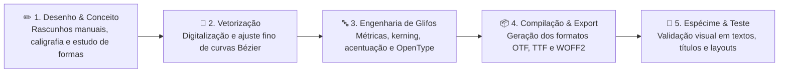

# ✒️ Fonts Portfolio — Da Ilustração à Tipografia

<p align="center">
  
  
  
</p>

<p align="center">
  <i>Um laboratório tipográfico autoral focado em transformar traços, ilustrações manuais e experimentações gráficas em fontes digitais completas e funcionais.</i>
</p>

---

## 🎨 Sobre o Projeto

Este repositório foi criado para ser o **acervo e atelier digital** de criação de fontes tipográficas.

Cada fonte aqui nasce fora do computador: no caderno de rascunhos, nas folhas soltas, na caneta nanquim, no lápis, no pincel ou na pintura digital. O objetivo deste projeto é preservar a alma, o gesto e a organicidade do desenho manual enquanto desenvolvemos a precisão técnica necessária para que o resultado funcione impecavelmente em softwares gráficos, sistemas operacionais e na web.

> *"A tipografia é a voz do texto — e desenhar letras é dar corpo e sotaque a essa voz."*

---

## 🧭 Do Esboço ao Glifo (Pipeline de Criação)

O processo criativo e técnico segue um ciclo artesanal e estruturado:



1. **Desenho & Pesquisa:** Estudos de ritmo, contraste, espessuras e proporções em papel ou mesa digitalizadora.
2. **Vetorização Precisa:** Limpeza de ruído e construção de caminhos limpos com o menor número possível de âncoras.
3. **Métricas & Espaçamento:** Ajuste individual de avanço (advance width), pares de kerning e conjunto de caracteres (A-Z, numerais, pontuação e diacríticos para o português e outros idiomas).
4. **Exportação & Otimização:** Conversão para formatos OpenType (`.otf`), TrueType (`.ttf`) e fontes para a web (`.woff` / `.woff2`).
5. **Amostra Tipográfica (Specimen):** Criação de pôsteres e amostras demonstrando o comportamento em diferentes corpos de texto.

---

## 🗂️ Estrutura do Repositório

O repositório é organizado para separar o produto final pronto para uso das etapas de processo:

```text
fonts/
│
├── fonts/               # 📦 Arquivos compilados das fontes prontos para instalar e usar
│   ├── otf/             # OpenType Font (ideal para desktop e softwares de design)
│   ├── ttf/             # TrueType Font (compatibilidade universal)
│   └── web/             # WOFF / WOFF2 (otimizado para websites e apps)
│
├── sources/             # 🎨 Arquivos de origem e processo criativo
│   ├── drawings/        # Scans, fotos dos sketches e rascunhos originais
│   └── vectors/         # Arquivos vetoriais brutos (SVG, EPS, Illustrator, etc.)
│
├── specimens/           # 🖼️ Amostras visuais, testes de texto e cartazes de apresentação
├── docs/                # 📝 Notas sobre características de cada família e histórico de versões
├── .gitignore           # Ignora temporários e caches de editores tipográficos
└── README.md            # Documentação principal do repositório
```

---

## 📚 Catálogo de Fontes

| Fonte | Estilo / Vibe | Conjunto Suportado | Formatos | Status |
| :--- | :--- | :--- | :---: | :---: |
| *[Em breve]* | *Display / Expressiva* | Básico + Acentuação PT | `.otf`, `.ttf`, `.woff2` | 🟡 *Em desenvolvimento* |
| *[Em breve]* | *Handwritten / Caligráfica* | Básico | `.otf`, `.ttf` | ⚪ *Planejada* |

> *Conforme novas fontes forem produzidas e lapidadas, elas serão listadas nesta tabela com links diretos de download e preview.*

---

## 🚀 Como Instalar e Utilizar

### No Computador (Desktop)
1. Acesse a pasta `fonts/otf` ou `fonts/ttf`.
2. Baixe o arquivo da fonte desejada (ex: `NomeDaFonte-Regular.otf`).
3. Dê dois cliques no arquivo baixado e clique em **Instalar Fonte** (Windows / macOS / Linux).
4. A fonte estará disponível no Photoshop, Illustrator, Figma, Canva, Word, etc.

### Na Web (@font-face)
Copie o arquivo `.woff2` da pasta `fonts/web/` para seu projeto e declare no seu CSS:

```css
@font-face {
  font-family: 'NomeDaFonte';
  src: url('./fonts/web/NomeDaFonte.woff2') format('woff2');
  font-weight: normal;
  font-style: normal;
  font-display: swap;
}

body {
  font-family: 'NomeDaFonte', sans-serif;
}
```

---

## 🛠️ Ferramentas Utilizadas

- **Papel, canetas e tintas:** Nanquim, brush pen, marcadores e grafite
- **Digitalização:** Scanner de alta resolução & Procreate / Photoshop
- **Vetorização:** Adobe Illustrator / Inkscape
- **Criação & Edição Tipográfica:** Glyphs / FontForge / BirdFont / RoboFont / Fontself
- **Otimização Web:** Fonttools & WOFF2 compressors

---

## ⚖️ Licença

As fontes e materiais gráficos deste repositório são protegidos por direitos autorais. Consulte o arquivo [LICENSE](LICENSE) para termos específicos de uso pessoal, comercial ou sob licença aberta (SIL Open Font License).

---

<p align="center">
  Feito com amor, café e muita ponta de caneta ✒️✨
</p>
